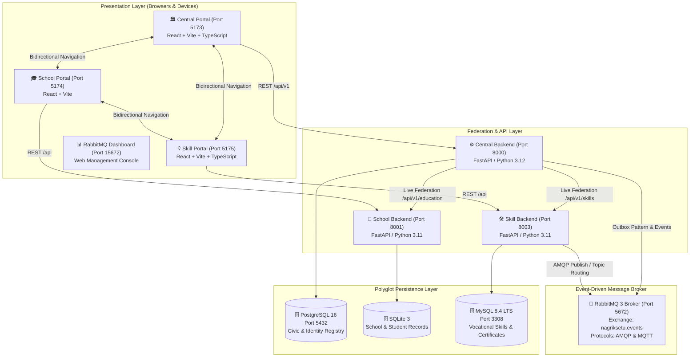

# NagrikSetu (नागरिक सेतु) — Federated Deployment & Teacher Demonstration Guide

This guide provides the complete production deployment blueprint, federated inter-service communication architecture (REST + AMQP/MQTT Message Broker), and a step-by-step presentation script to demonstrate the fully working platform to your professor or evaluation committee.

---

## 1. System Architecture & Inter-Service Communication

NagrikSetu operates on a **Federated Polyglot Microservices Architecture**:



---

## 2. Live Inter-Service Data Fetching Proofs

When your teacher asks: *"How do your microservices communicate and share data?"*, run these live terminal commands or open them in the browser:

### A. Live Federation: Central Portal &rarr; Skill Development Service
The Central Backend queries the Skill Development microservice (`http://skill_backend:8000`) over the internal Docker bridge:
```bash
curl -s http://localhost:8000/api/v1/skills/stats | jq .
```
**Expected Live Response:**
```json
{
  "status": "online",
  "service": "nagriksetu-skill-development",
  "portal_url": "http://localhost:5175",
  "total_programmes": 107,
  "training_centres": 8,
  "database": "MySQL 8.4 LTS",
  "schemes": [
    "Pradhan Mantri Kaushal Vikas Yojana (PMKVY 4.0)",
    "National Apprenticeship Promotion Scheme (NAPS)",
    "Craftsmen Training Scheme (ITI Technical)",
    "FutureSkills PRIME AI & Cloud Skilling Initiative"
  ],
  "integration_mode": "federated_rest_live"
}
```

### B. Live Federation: Central Portal &rarr; School & Education Service
The Central Backend queries the School microservice (`http://school_backend:8000`):
```bash
curl -s http://localhost:8000/api/v1/education/stats | jq .
```
**Expected Live Response:**
```json
{
  "status": "online",
  "total_schools": 30,
  "districts_covered": 12,
  "portal_url": "http://localhost:5174",
  "schemes": [
    "National Scholarship Portal (NSP)",
    "DigiLocker Marksheets & Certificates",
    "Pre/Post-Matric Grants for Minority & Rural Students",
    "RTE Admission Portal & Degree Verification"
  ],
  "integration_mode": "microservice_live"
}
```

### C. Live Domain Events & Outbox Integration
Central Portal provides an event-bus integration feed (`/api/v1/integrations/events`):
```bash
curl -s http://localhost:8000/api/v1/integrations/events | jq .
```

### D. Live Message Broker Web Dashboard
Open the RabbitMQ management console:
- **URL:** [http://localhost:15672](http://localhost:15672)
- **Username:** `nagriksetu`
- **Password:** `nagriksetu-mq-pass-2026`
- **Exchange:** `nagriksetu.events` (Topic Exchange)
- **Queues:** `skill.enrolments`, `skill.certificates`, `citizen.notifications`

---

## 3. Production Cloud Deployment Plan

To deploy NagrikSetu to the cloud (AWS EC2, DigitalOcean Droplet, Hetzner, or GCP Compute Engine):

### Phase 1: Provisioning Server (Ubuntu 24.04 LTS VPS)
1. **Minimum Specs:** 4 vCPU, 8 GB RAM, 50 GB SSD (handles all 9 containers with ease).
2. Install Docker & Docker Compose:
   ```bash
   sudo apt update && sudo apt upgrade -y
   curl -fsSL https://get.docker.com -o get-docker.sh && sudo sh get-docker.sh
   sudo usermod -aG docker $USER
   ```

### Phase 2: Domain Names & Reverse Proxy Configuration
Assign subdomains pointing to your server's Public Elastic IP:
- `nagriksetu.gov.in` &rarr; Central Portal (`5173`)
- `schools.nagriksetu.gov.in` &rarr; Education Portal (`5174`)
- `skills.nagriksetu.gov.in` &rarr; Skill Development (`5175`)
- `api.nagriksetu.gov.in` &rarr; Central API (`8000`)
- `mq.nagriksetu.gov.in` &rarr; RabbitMQ UI (`15672`)

### Phase 3: Host Nginx + Let's Encrypt SSL
Install Nginx on the host server:
```nginx
server {
    server_name nagriksetu.gov.in;
    location / {
        proxy_pass http://127.0.0.1:5173;
        proxy_set_header Host $host;
        proxy_set_header X-Real-IP $remote_addr;
    }
    location /api/ {
        proxy_pass http://127.0.0.1:8000/api/;
    }
}
```
Obtain free trusted SSL certificates:
```bash
sudo apt install certbot python3-certbot-nginx -y
sudo certbot --nginx -d nagriksetu.gov.in -d schools.nagriksetu.gov.in -d skills.nagriksetu.gov.in
```

### Phase 4: Production Container Deployment
Clone repository and launch:
```bash
git clone https://github.com/VIDYASAGAR08/nagriksetu.git
cd nagriksetu
docker compose up -d
```
All 9 containers start automatically with healthchecks and restart policies.

---

## 4. University Presentation Walkthrough (Step-by-Step)

Follow this exact 5-step script during your demonstration:

### Step 1: Open the Central Portal (Port 5173)
- Navigate to: **[http://localhost:5173](http://localhost:5173)**
- **What to say:**
  > *"NagrikSetu is a unified civic platform. From the central landing page, citizens can access administrative services, WhatsApp AI assistant, Education services, and Vocational Skill Development."*
- Point out the **"Live Service"** badges on the Education and Skill cards.

### Step 2: Seamless One-Click Microservice Navigation
- Click **"Explore Schools & Portals"** &rarr; Instantly navigates to **[http://localhost:5174](http://localhost:5174)**.
  - Notice the header with the tricolor flag and the return buttons:
    - `🏛️ Central Portal (Port 5173)`
    - `💡 Skill Development (Port 5175)`
- Click **"Skill Development (Port 5175)"** &rarr; Instantly transitions to **[http://localhost:5175](http://localhost:5175)**.
  - Show the skill programmes, training centres, Kannada/English toggle, and government utility bar.
- Click **"Central Portal (Port 5173)"** &rarr; Return to the main portal.

### Step 3: Show Polyglot Databases
Open 3 terminal tabs to show the 3 independent databases:
1. **PostgreSQL 16 (Central DB):**
   ```bash
   docker exec -it nagriksetu_postgres psql -U postgres -d civicadmin_db -c "\dt"
   ```
2. **SQLite 3 (School DB):**
   ```bash
   docker exec -it nagriksetu_school_backend python -c "import sqlite3; c=sqlite3.connect('/app/data/nagriksetu.db'); print('Total Schools:', c.execute('SELECT count(*) FROM schools').fetchone()[0])"
   ```
3. **MySQL 8.4 (Skill DB):**
   ```bash
   docker exec -it nagriksetu_skill_db mysql -u nagriksetu_skill -pskill-app-pass-2026 skill_db -e "SHOW TABLES; SELECT count(*) AS total_skills FROM skills;"
   ```

### Step 4: Show Live Message Broker (RabbitMQ)
- Open: **[http://localhost:15672](http://localhost:15672)** (User: `nagriksetu` / Pass: `nagriksetu-mq-pass-2026`).
- **What to say:**
  > *"Our microservices are decoupled. When a student enrolls or receives a certificate, the Skill Service publishes an AMQP domain event to RabbitMQ, enabling asynchronous processing and notification delivery."*

### Step 5: Show the Automated GitHub Actions CI/CD Pipeline
- Open: **[https://github.com/VIDYASAGAR08/nagriksetu/actions](https://github.com/VIDYASAGAR08/nagriksetu/actions)**
- **What to say:**
  > *"We have an enterprise-grade CI/CD pipeline running on GitHub Actions. Every commit automatically builds the TypeScript frontends in parallel, executes 55+ automated pytest tests across PostgreSQL and MySQL service containers, verifies Docker Compose images, and packages release deployment manifests."*

### Step 6: Demonstrate Cross-Service Single Sign-On (SSO)
Demonstrate that a citizen only registers once, and can access all independent services with the exact same credentials:
1. **Central Portal (`http://localhost:5173`)**:
   - Citizen `aarav.sharma@example.com` / `CitizenPass123!@` is registered in Central PostgreSQL registry.
2. **School Education Portal (`http://localhost:5174/login`)**:
   - Enter `aarav.sharma@example.com` and `CitizenPass123!@`.
   - **Click Login**: The School service instantly federates with Central Portal via `/api/v1/auth/federated-verify`, verifies credentials with Argon2, auto-provisions a verified parent account (`PRN-2026-XXXXXX`), links their household children, and logs in directly to the Parent Dashboard!
3. **Skill Development Portal (`http://localhost:5175/login`)**:
   - Enter `aarav.sharma@example.com` and `CitizenPass123!@`.
   - **Click Sign In**: Skill Development service authenticates via Central Portal, provisions the citizen account (`CIT-88219011`), and takes the citizen directly into the vocational skill dashboard!

### Step 7: Demonstrate Parent Student Access & School Applications
1. On **School Portal (`http://localhost:5174/parent`)**:
   - Notice the **"My Children"** tab:
     - Shows **Asha Sharma** (Daughter), linked directly from the Central Citizen Household Registry (`HHD-1001-BLR`)!
     - Click **"📊 View Academic Results & Documents"**: View real-time marks, attendance, and official report cards.
     - Click **"✏️ Edit Profile Details"**: Parents can directly update student name, date of birth, gender, and language preference. Changes update school records and write to the audit trail (`AUD-SCH-2026-XXXX`).
     - Click **"📝 Field Request"**: Submit formal official update requests with supporting certificates.
   - Go to **"Admissions Desk"** (`/parent?tab=admissions`):
     - View applications submitted for children (`APP-2026-SCH002-EF1E88`).
     - Parents can apply for new admissions to any School, PU College, or Polytechnic directly on behalf of their child with one click!

---

## 4. Standardized Domain-Prefixed Business ID Architecture

To satisfy strict enterprise security and government audit standards, **naive integer IDs (`1, 2, 3...`) have been eliminated from all external APIs, interfaces, and primary business identifiers**. Every record uses a domain-prefixed, year-stamped, collision-resistant identifier:

| Microservice | Entity Domain | Professional Business ID Format | Example Identifier |
| :--- | :--- | :--- | :--- |
| **Central Portal (Postgres)** | Citizen Registry | `CIT-YYYY-XXXXXX` | `CIT-2026-CH001`, `CIT-88219011` |
| **Central Portal (Postgres)** | User Accounts | `USR-YYYY-XXXX` | `USR-2026-0003`, `USR-2026-0004` |
| **Central Portal (Postgres)** | Households | `HHD-YYYY-XXXX` | `HHD-2026-1001BLR`, `HHD-1001-BLR` |
| **Central Portal (Postgres)** | Memberships | `HMB-YYYY-XXXXXX` | `HMB-2026-000003` |
| **Central Portal (Postgres)** | Audit Events | `AUD-YYYY-XXXXXX` | `AUD-2026-7A8B9C` |
| **Central Portal (Postgres)** | Education Record | `EDU-YYYY-XXXXXX` | `EDU-2026-000001` |
| **School Service (SQLite)** | Institutions | `SCH-XXX` / `SCH-BLR-XXX` | `SCH001`, `SCH002` |
| **School Service (SQLite)** | Enrolled Students | `STU-YYYY-XXXX` & `NS-XXXX` | `SCH01125`, `NS-FB8336A812DE468FB8E475443CF673EB` |
| **School Service (SQLite)** | Parents / Guardians | `PRN-YYYY-XXXX` / `GRD-YYYY-XXXX` | `PRN-2026-2F2ED4`, `GRD-2026-A1B2C3` |
| **School Service (SQLite)** | Student-Parent Link | `SGL-YYYY-XXXX` | `SGL-2026-E5F6G7` |
| **School Service (SQLite)** | Admission Application | `APP-YYYY-INST-XXXX` | `APP-2026-SCH002-EF1E88` |
| **School Service (SQLite)** | Update Request | `UPR-YYYY-XXXX` | `UPR-2026-D4E5F6` |
| **Skill Service (MySQL)** | Citizen Reference | `CIT-YYYY-XXXXXX` | `CIT-000002`, `CIT-2026-000003` |
| **Skill Service (MySQL)** | Training Program | `PRG-YYYY-XXXX` | `PRG-2026-0001`, `PRG-0001` |
| **Skill Service (MySQL)** | Training Batch | `BAT-YYYY-XXXX` | `BAT-2026-0001`, `BAT-0001` |
| **Skill Service (MySQL)** | Enrollment Record | `ENR-YYYY-XXXXXX` | `ENR-2026-000001`, `ENR-000001` |
| **Skill Service (MySQL)** | Skill Certificate | `CRT-YYYY-XXXXXX` | `CRT-2026-000001`, `CRT-000001` |
| **Skill Service (MySQL)** | Training Centre | `CTR-YYYY-XXXX` | `CTR-0001`, `CTR-0002` |

---

## 5. How to Open & Show the 3 Independent Databases to Evaluators

Evaluators can inspect the databases in two convenient ways:

### Option A: Open the SQL Dump Files Directly
Pre-generated standard SQL dump files are ready in the `database_dumps/` directory:
- [central_civic_portal_postgres.sql](file:///Users/macbookpro/Documents/sad%201/database_dumps/central_civic_portal_postgres.sql) — Full PostgreSQL civic schema, citizen profiles, households, and audit logs.
- [school_education_service.sql](file:///Users/macbookpro/Documents/sad%201/database_dumps/school_education_service.sql) — Complete SQLite schema, schools, student records, admissions, and parent linkages.
- [skill_development_service.sql](file:///Users/macbookpro/Documents/sad%201/database_dumps/skill_development_service.sql) — MySQL schema, vocational skills, training programmes, batches, and certificates.

You can double-click or open any of these `.sql` files directly in TablePlus, DBeaver, VS Code, or any text editor to show the teacher the table definitions and row inserts.

### Option B: Live GUI Connection (TablePlus / DBeaver)

| Service | Database Type | Host | Port | Database Name | Username | Password |
| :--- | :--- | :--- | :--- | :--- | :--- | :--- |
| **Central Portal** | PostgreSQL | `127.0.0.1` | **5432** | `civicadmin_db` | `postgres` | `postgres` |
| **School Service** | SQLite 3 | *File Path* | — | `./School service/backend/data/nagriksetu.db` | — | — |
| **Skill Service** | MySQL 8.4 | `127.0.0.1` | **3308** | `skill_db` | `root` | `root_password_2026` |
*(Note for TablePlus MySQL connection: Use `127.0.0.1` and port `3308` rather than `localhost` to connect directly over TCP).*

