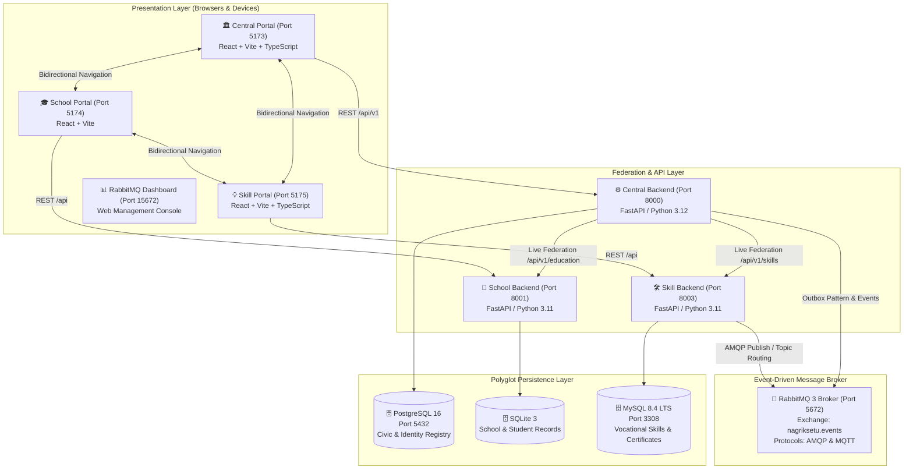

# NagrikSetu (नागरिक सेतु) — Federated Deployment & Teacher Demonstration Guide

This guide provides the complete production deployment blueprint, federated inter-service communication architecture (REST + AMQP/MQTT Message Broker), and a step-by-step presentation script to demonstrate the fully working platform to your professor or evaluation committee.

---

## 1. System Architecture & Inter-Service Communication

NagrikSetu operates on a **Federated Polyglot Microservices Architecture**:



---

## 2. Live Inter-Service Data Fetching Proofs

When your teacher asks: *"How do your microservices communicate and share data?"*, run these live terminal commands or open them in the browser:

### A. Live Federation: Central Portal &rarr; Skill Development Service
The Central Backend queries the Skill Development microservice (`http://skill_backend:8000`) over the internal Docker bridge:
```bash
curl -s http://localhost:8000/api/v1/skills/stats | jq .
```
**Expected Live Response:**
```json
{
  "status": "online",
  "service": "nagriksetu-skill-development",
  "portal_url": "http://localhost:5175",
  "total_programmes": 107,
  "training_centres": 8,
  "database": "MySQL 8.4 LTS",
  "schemes": [
    "Pradhan Mantri Kaushal Vikas Yojana (PMKVY 4.0)",
    "National Apprenticeship Promotion Scheme (NAPS)",
    "Craftsmen Training Scheme (ITI Technical)",
    "FutureSkills PRIME AI & Cloud Skilling Initiative"
  ],
  "integration_mode": "federated_rest_live"
}
```

### B. Live Federation: Central Portal &rarr; School & Education Service
The Central Backend queries the School microservice (`http://school_backend:8000`):
```bash
curl -s http://localhost:8000/api/v1/education/stats | jq .
```
**Expected Live Response:**
```json
{
  "status": "online",
  "total_schools": 30,
  "districts_covered": 12,
  "portal_url": "http://localhost:5174",
  "schemes": [
    "National Scholarship Portal (NSP)",
    "DigiLocker Marksheets & Certificates",
    "Pre/Post-Matric Grants for Minority & Rural Students",
    "RTE Admission Portal & Degree Verification"
  ],
  "integration_mode": "microservice_live"
}
```

### C. Live Domain Events & Outbox Integration
Central Portal provides an event-bus integration feed (`/api/v1/integrations/events`):
```bash
curl -s http://localhost:8000/api/v1/integrations/events | jq .
```

### D. Live Message Broker Web Dashboard
Open the RabbitMQ management console:
- **URL:** [http://localhost:15672](http://localhost:15672)
- **Username:** `nagriksetu`
- **Password:** `nagriksetu-mq-pass-2026`
- **Exchange:** `nagriksetu.events` (Topic Exchange)
- **Queues:** `skill.enrolments`, `skill.certificates`, `citizen.notifications`

---

## 3. Production Cloud Deployment Plan

To deploy NagrikSetu to the cloud (AWS EC2, DigitalOcean Droplet, Hetzner, or GCP Compute Engine):

### Phase 1: Provisioning Server (Ubuntu 24.04 LTS VPS)
1. **Minimum Specs:** 4 vCPU, 8 GB RAM, 50 GB SSD (handles all 9 containers with ease).
2. Install Docker & Docker Compose:
   ```bash
   sudo apt update && sudo apt upgrade -y
   curl -fsSL https://get.docker.com -o get-docker.sh && sudo sh get-docker.sh
   sudo usermod -aG docker $USER
   ```

### Phase 2: Domain Names & Reverse Proxy Configuration
Assign subdomains pointing to your server's Public Elastic IP:
- `nagriksetu.gov.in` &rarr; Central Portal (`5173`)
- `schools.nagriksetu.gov.in` &rarr; Education Portal (`5174`)
- `skills.nagriksetu.gov.in` &rarr; Skill Development (`5175`)
- `api.nagriksetu.gov.in` &rarr; Central API (`8000`)
- `mq.nagriksetu.gov.in` &rarr; RabbitMQ UI (`15672`)

### Phase 3: Host Nginx + Let's Encrypt SSL
Install Nginx on the host server:
```nginx
server {
    server_name nagriksetu.gov.in;
    location / {
        proxy_pass http://127.0.0.1:5173;
        proxy_set_header Host $host;
        proxy_set_header X-Real-IP $remote_addr;
    }
    location /api/ {
        proxy_pass http://127.0.0.1:8000/api/;
    }
}
```
Obtain free trusted SSL certificates:
```bash
sudo apt install certbot python3-certbot-nginx -y
sudo certbot --nginx -d nagriksetu.gov.in -d schools.nagriksetu.gov.in -d skills.nagriksetu.gov.in
```

### Phase 4: Production Container Deployment
Clone repository and launch:
```bash
git clone https://github.com/VIDYASAGAR08/nagriksetu.git
cd nagriksetu
docker compose up -d
```
All 9 containers start automatically with healthchecks and restart policies.

---

## 4. University Presentation Walkthrough (Step-by-Step)

Follow this exact 5-step script during your demonstration:

### Step 1: Open the Central Portal (Port 5173)
- Navigate to: **[http://localhost:5173](http://localhost:5173)**
- **What to say:**
  > *"NagrikSetu is a unified civic platform. From the central landing page, citizens can access administrative services, WhatsApp AI assistant, Education services, and Vocational Skill Development."*
- Point out the **"Live Service"** badges on the Education and Skill cards.

### Step 2: Seamless One-Click Microservice Navigation
- Click **"Explore Schools & Portals"** &rarr; Instantly navigates to **[http://localhost:5174](http://localhost:5174)**.
  - Notice the header with the tricolor flag and the return buttons:
    - `🏛️ Central Portal (Port 5173)`
    - `💡 Skill Development (Port 5175)`
- Click **"Skill Development (Port 5175)"** &rarr; Instantly transitions to **[http://localhost:5175](http://localhost:5175)**.
  - Show the skill programmes, training centres, Kannada/English toggle, and government utility bar.
- Click **"Central Portal (Port 5173)"** &rarr; Return to the main portal.

### Step 3: Show Polyglot Databases
Open 3 terminal tabs to show the 3 independent databases:
1. **PostgreSQL 16 (Central DB):**
   ```bash
   docker exec -it nagriksetu_postgres psql -U postgres -d civicadmin_db -c "\dt"
   ```
2. **SQLite 3 (School DB):**
   ```bash
   docker exec -it nagriksetu_school_backend python -c "import sqlite3; c=sqlite3.connect('/app/data/nagriksetu.db'); print('Total Schools:', c.execute('SELECT count(*) FROM schools').fetchone()[0])"
   ```
3. **MySQL 8.4 (Skill DB):**
   ```bash
   docker exec -it nagriksetu_skill_db mysql -u nagriksetu_skill -pskill-app-pass-2026 skill_db -e "SHOW TABLES; SELECT count(*) AS total_skills FROM skills;"
   ```

### Step 4: Show Live Message Broker (RabbitMQ)
- Open: **[http://localhost:15672](http://localhost:15672)** (User: `nagriksetu` / Pass: `nagriksetu-mq-pass-2026`).
- **What to say:**
  > *"Our microservices are decoupled. When a student enrolls or receives a certificate, the Skill Service publishes an AMQP domain event to RabbitMQ, enabling asynchronous processing and notification delivery."*

### Step 5: Show the Automated GitHub Actions CI/CD Pipeline
- Open: **[https://github.com/VIDYASAGAR08/nagriksetu/actions](https://github.com/VIDYASAGAR08/nagriksetu/actions)**
- **What to say:**
  > *"We have an enterprise-grade CI/CD pipeline running on GitHub Actions. Every commit automatically builds the TypeScript frontends in parallel, executes 55+ automated pytest tests across PostgreSQL and MySQL service containers, verifies Docker Compose images, and packages release deployment manifests."*
