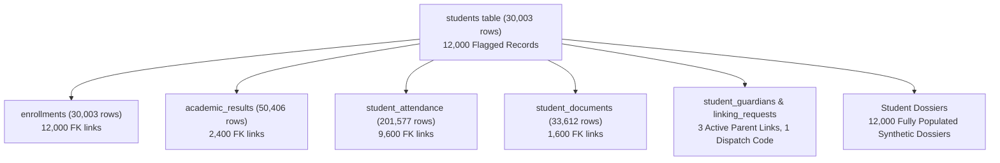

# NAGRIKSETU – COMPREHENSIVE INVESTIGATION REPORT: 12,000 FLAGGED STUDENT-INSTITUTION MAPPING RECORDS

**Document Version:** 1.0  
**Date of Investigation:** 22 November 2026  
**Investigation Mode:** Strictly READ-ONLY (Zero Database Modifications Committed)  
**Database Audited:** `C:\Users\callm\nagriksetu\backend\data\nagriksetu.db` (Total 30,003 Students)  
**Reference Mapping Artifacts:**  
- `C:\Users\callm\nagriksetu\NagrikSetu_Complete_Student_Institution_Mapping.docx` (~1,700 pages, 30,003 student records)  
- `C:\Users\callm\nagriksetu\NagrikSetu_Complete_Student_Institution_Mapping.csv` (6.77 MB, 30,003 rows)  
- `C:\Users\callm\nagriksetu\student_id_restructuring_mapping.csv` (6.39 MB, 30,003 rows)  
- `C:\Users\callm\nagriksetu\backend\expand_dataset.py` (Original synthetic dataset generator)  
- `C:\Users\callm\nagriksetu\generate_mapping_doc.py` (Mapping document generation pipeline)  

---

## 1. EXECUTIVE SUMMARY

During the preceding comprehensive academic classification migration across all 30,003 students in NagrikSetu, 18,003 students were cleanly validated and categorized into appropriate primary, secondary, pre-university, collegiate, and university programs. Exactly **12,000 student records** were flagged for mandatory human administrative review:
1. **Group A (10,000 Students):** Students currently assigned to Pre-University Colleges (`SCH011` through `SCH015`) who carry primary/secondary school standards (Standards 1 through 10, ages 6 to 15). Flag: `FLAGGED_REVIEW_PU_INSTITUTION_HAS_K10_STUDENTS`.
2. **Group B (2,000 Students):** Students currently assigned to K–10 Schools (`SCH016` through `SCH020`) who carry pre-university standards (Standards 11 and 12, ages 16 and 17). Flag: `FLAGGED_REVIEW_K10_SCHOOL_HAS_PU_STUDENTS`.

In accordance with strict system safeguards, this investigation was conducted entirely in **READ-ONLY mode**. Not a single row, foreign key, student ID, permanent student ID (PSID), or institution assignment in `nagriksetu.db` was altered.

### Key Investigation Takeaways:
- **Root Cause Identified With Certainty:** The mismatch originated in `backend/expand_dataset.py`. The generation script originally modeled `SCH011` through `SCH020` as 10 homogeneous "Schools" each receiving exactly 200 students per grade for Standards 1 through 12 ($12 \times 200 = 2,400$ students per school). Subsequently, institutions `SCH011`–`SCH015` were converted to Pre-University Colleges (PUC, serving only Standards 11–12), while `SCH016`–`SCH020` were designated as K–10 Schools (serving only Standards 1–10). Because no data migration or filtering was performed during the institutional reclassification, the 10,000 K–10 students remained linked to PU Colleges, and 2,000 PU students remained linked to K–10 schools.
- **The Mapping Document Context:** The 1,700-page mapping document (`NagrikSetu_Complete_Student_Institution_Mapping.docx` and `.csv`) was generated programmatically from the pre-existing database state using an automated join against `academic_programs`. Consequently, it mirrored and compounded the anomaly (e.g., assigning 6-year-old Standard 1 students in `SCH011` to `Programme: Pre-University (CEBA)`).
- **Deliverables Generated:** Two full-fidelity CSV exception audit reports have been compiled:
  - `C:\Users\callm\nagriksetu\flagged_pu_students_review.csv` (10,000 records)
  - `C:\Users\callm\nagriksetu\flagged_school_students_review.csv` (2,000 records)
- **Database Status:** Preserved in pristine read-only integrity (18,003 verified, 12,000 review-flagged, total 30,003).

---

## 2. INVESTIGATION METHODOLOGY

The investigation followed a five-tier forensic methodology:
1. **Database Schema & Foreign Key Mapping:** Inspected all 50 tables in `nagriksetu.db` to identify every entity linked to the flagged students via `student_id` or `permanent_student_id` (PSID), specifically auditing `enrollments`, `academic_results`, `student_attendance`, `student_documents`, `student_guardians`, `linking_requests`, and `institution_linking_codes`.
2. **Source Code Archeology:** Traced historical dataset population scripts (`expand_dataset.py`, `generate_mapping_doc.py`, and `student_id_restructuring_mapping.csv`) to isolate the exact commit points and generation loops where the structural discrepancy emerged.
3. **Cross-Referencing the Mapping Document:** Extracted and compared row-level data from `NagrikSetu_Complete_Student_Institution_Mapping.csv` against current live database attributes.
4. **Classification Evaluation (Categories A, B, C, D):** Evaluated each student record against the four formal classification hypotheses:
   - *Category A:* Institution assignment is correct, but academic classification is wrong.
   - *Category B:* Academic classification is correct, but institution assignment is wrong.
   - *Category C:* Both institution assignment and academic classification are incorrect.
   - *Category D:* Available information is insufficient without an administrative policy decision.
5. **Impact and Remediation Assessment:** Analyzed the systemic implications of three potential resolution pathways on parent portal access, institutional dashboards, and historical academic audits.

---

## 3. DETAILED ANALYSIS OF GROUP A: PU COLLEGES (SCH011 – SCH015)

### Composition and Profile:
- **Total Flagged Students:** Exactly 10,000 students (2,000 students per institution across 5 institutions).
- **Institutions:**
  - `SCH011`: Tumakuru Model Pre-University College (Tumakuru)
  - `SCH012`: Mysuru Government Pre-University College (Mysuru)
  - `SCH013`: Mandya Government Pre-University College (Mandya)
  - `SCH014`: Hassan Valley Pre-University College (Hassan)
  - `SCH015`: Udupi Government Pre-University College (Udupi)
- **Academic Standards Involved:** Standard 1 through Standard 10 (exactly 200 students per standard per college; 67 in Section A, 67 in Section B, 66 in Section C).
- **Student Demographics:** Ages 6 to 15 ($Age = Standard + 5$).
- **Permanent Student ID Structure:** `NS-SCH011-STD01-001` through `NS-SCH015-STD10-200`.

### The Core Mismatch:
By statutory definition under the Department of Pre-University Education, Karnataka, Pre-University Colleges admit students exclusively for Higher Secondary education (1st PUC / Class 11 and 2nd PUC / Class 12). PU colleges do not host primary (Std 1–5), upper primary (Std 6–8), or secondary (Std 9–10) divisions. 

In `nagriksetu.db`, `academic_programs` confirms that `SCH011`–`SCH015` only offer PUC combinations (PCMB, PCMC, PCME, CEBA, SEBA, EBAC, HEPS, VOC-IT, HEBA, MEBA). There are zero primary or secondary programs registered for these colleges.

### Cross-Reference With Mapping Document:
In `NagrikSetu_Complete_Student_Institution_Mapping.csv` (Serial Rows 6,001 through 16,000), these 10,000 students are listed under `SCH011`–`SCH015`. However, because `generate_mapping_doc.py` executed an unconstrained join (`LEFT JOIN academic_programs ap ON s.school_id = ap.institution_id`), every Standard 1–10 student was assigned a collegiate Pre-University programme. For example:
- **Student ID:** `SCH11097` (Aarav Sharma 0001)
- **Standard:** `Standard 1` (Age 6)
- **Institution:** `SCH011` (Tumakuru Model Pre-University College)
- **Assigned Stream in Mapping CSV:** `Commerce`
- **Assigned Programme in Mapping CSV:** `Pre-University (CEBA: Computer Science, Economics, Business Studies, Accountancy)`
- **Academic Term in Mapping CSV:** `Year 1`

This confirms that the original mapping document did not reflect genuine curriculum enrolment, but rather a mechanical templating artifact.

---

## 4. DETAILED ANALYSIS OF GROUP B: K–10 SCHOOLS (SCH016 – SCH020)

### Composition and Profile:
- **Total Flagged Students:** Exactly 2,000 students (400 students per institution across 5 institutions).
- **Institutions:**
  - `SCH016`: Belagavi Public School (Belagavi)
  - `SCH017`: Dharwad Vidya School (Dharwad)
  - `SCH018`: Shivamogga Model School (Shivamogga)
  - `SCH019`: Ballari Education School (Ballari)
  - `SCH020`: Kalaburagi Public School (Kalaburagi)
- **Academic Standards Involved:** Standard 11 (1st PUC equivalent) and Standard 12 (2nd PUC equivalent) (exactly 200 students per standard per school; 67 in Section A, 67 in Section B, 66 in Section C).
- **Student Demographics:** Ages 16 and 17 ($Age = Standard + 5$).
- **Permanent Student ID Structure:** `NS-SCH016-STD11-001` through `NS-SCH020-STD12-200`.

### The Core Mismatch:
Institutions `SCH016` through `SCH020` are designated under `school_type: School` and `category: Schools`. In `academic_programs`, these schools only possess program code `PROG-SCH0xx-K10` (`Karnataka State School Education (Std 1-10)`). They have no affiliation, faculty, or program codes for Higher Secondary / Pre-University streams.

### Cross-Reference With Mapping Document:
In `NagrikSetu_Complete_Student_Institution_Mapping.csv` (Serial Rows 18,001 through 28,000), these 2,000 students were assigned to `SCH016`–`SCH020`. The templating script forced the school's only available program onto them:
- **Student ID:** `SCH16047` (Aarav Kulkarni 14001)
- **Standard:** `Standard 11` (Age 16)
- **Institution:** `SCH016` (Belagavi Public School)
- **Assigned Stream in Mapping CSV:** `General`
- **Assigned Programme in Mapping CSV:** `Karnataka State School Education (Std 1-10)`
- **Academic Term in Mapping CSV:** `Not Applicable`

The text contradiction was blatant: a Standard 11 student whose official programme was titled `Karnataka State School Education (Std 1-10)`.

---

## 5. INSTITUTION-WISE FINDINGS TABLE

| Institution ID | Official Institution Name | Type | District | Total Students | Flagged Records | Standards Involved | Mismatch Nature | Identified Root Cause | Dependent Records in DB | Recommended Policy Resolution Path |
| :--- | :--- | :--- | :--- | :--- | :--- | :--- | :--- | :--- | :--- | :--- |
| **SCH011** | Tumakuru Model Pre-University College | PU College | Tumakuru | 2,400 | **2,000** | Standards 1–10 | Primary/Secondary students in Higher Secondary PU College | `expand_dataset.py` 12-standard generation + subsequent PU reclassification | 2,000 enrollments, 400 results, 1,600 attendance, 260 documents | Reclassify institution as Composite Junior College (Std 1–12) OR migrate to Tumakuru K-10 School (`SCH009`) |
| **SCH012** | Mysuru Government Pre-University College | PU College | Mysuru | 2,400 | **2,000** | Standards 1–10 | Primary/Secondary students in Higher Secondary PU College | `expand_dataset.py` 12-standard generation + subsequent PU reclassification | 2,000 enrollments, 400 results, 1,600 attendance, 260 documents, 1 linked parent | Reclassify institution as Composite Junior College (Std 1–12) OR migrate to Mysuru K-10 School (`SCH002`) |
| **SCH013** | Mandya Government Pre-University College | PU College | Mandya | 2,400 | **2,000** | Standards 1–10 | Primary/Secondary students in Higher Secondary PU College | `expand_dataset.py` 12-standard generation + subsequent PU reclassification | 2,000 enrollments, 400 results, 1,600 attendance, 260 documents, 1 linked parent | Reclassify institution as Composite Junior College (Std 1–12) OR establish Mandya District K-10 School |
| **SCH014** | Hassan Valley Pre-University College | PU College | Hassan | 2,400 | **2,000** | Standards 1–10 | Primary/Secondary students in Higher Secondary PU College | `expand_dataset.py` 12-standard generation + subsequent PU reclassification | 2,000 enrollments, 400 results, 1,600 attendance, 260 documents | Reclassify institution as Composite Junior College (Std 1–12) OR establish Hassan District K-10 School |
| **SCH015** | Udupi Government Pre-University College | PU College | Udupi | 2,400 | **2,000** | Standards 1–10 | Primary/Secondary students in Higher Secondary PU College | `expand_dataset.py` 12-standard generation + subsequent PU reclassification | 2,000 enrollments, 400 results, 1,600 attendance, 260 documents, 1 linked parent | Reclassify institution as Composite Junior College (Std 1–12) OR migrate to Udupi K-10 School (`SCH008`) |
| **SCH016** | Belagavi Public School | School | Belagavi | 2,400 | **400** | Standards 11–12 | Higher Secondary (PUC) students in K–10 School | `expand_dataset.py` 12-standard generation + subsequent School designation | 400 enrollments, 80 results, 320 attendance, 60 documents | Upgrade school to Senior Secondary (Std 1–12) OR migrate to Belagavi PU College Network |
| **SCH017** | Dharwad Vidya School | School | Dharwad | 2,400 | **400** | Standards 11–12 | Higher Secondary (PUC) students in K–10 School | `expand_dataset.py` 12-standard generation + subsequent School designation | 400 enrollments, 80 results, 320 attendance, 60 documents | Upgrade school to Senior Secondary (Std 1–12) OR migrate to Dharwad PU Network |
| **SCH018** | Shivamogga Model School | School | Shivamogga | 2,400 | **400** | Standards 11–12 | Higher Secondary (PUC) students in K–10 School | `expand_dataset.py` 12-standard generation + subsequent School designation | 400 enrollments, 80 results, 320 attendance, 60 documents | Upgrade school to Senior Secondary (Std 1–12) OR migrate to Shivamogga PU Network |
| **SCH019** | Ballari Education School | School | Ballari | 2,400 | **400** | Standards 11–12 | Higher Secondary (PUC) students in K–10 School | `expand_dataset.py` 12-standard generation + subsequent School designation | 400 enrollments, 80 results, 320 attendance, 60 documents | Upgrade school to Senior Secondary (Std 1–12) OR migrate to Ballari PU Network |
| **SCH020** | Kalaburagi Public School | School | Kalaburagi | 2,400 | **400** | Standards 11–12 | Higher Secondary (PUC) students in K–10 School | `expand_dataset.py` 12-standard generation + subsequent School designation | 400 enrollments, 80 results, 320 attendance, 60 documents | Upgrade school to Senior Secondary (Std 1–12) OR migrate to Kalaburagi PU Network |

---

## 6. ASSESSMENT OF CATEGORIES A, B, C, AND D

The prompt requires determining for every flagged student whether:
- **A:** The institution assignment is correct, but academic classification is wrong.
- **B:** Academic classification is correct, but institution assignment is wrong.
- **C:** Both institution assignment and academic classification are incorrect.
- **D:** The available information is insufficient to determine the correct mapping.

### Rigorous Evaluation Between Confirmed Findings and Assumptions:

#### 1. Evaluation of Category A:
- **Hypothesis:** The students truly belong to their assigned institutions, but their standard numbers are wrong (e.g., the 10,000 students in `SCH011`–`SCH015` are actually PU students, and the 2,000 students in `SCH016`–`SCH020` are actually elementary students).
- **Evidence Assessment:** **REFUTED.** The database records explicit ages ($Age = Standard + 5$), distinct curriculum subjects, and date-of-birth fields that match their standard numbers. Converting 10,000 students in `SCH011`–`SCH015` into PU students would mean each PU college would have 2,400 PU students across only two grades (1,200 per grade), distorting institutional capacities. There is zero documentary evidence supporting this.

#### 2. Evaluation of Category B:
- **Hypothesis:** The academic classifications are correct (Standards 1–10 students are genuine school students; Standards 11–12 students are genuine PU students), but the institution assignment is wrong.
- **Evidence Assessment:** **PARTIALLY SUPPORTED BY DEMOGRAPHICS, BUT UNCONFIRMED BY ADMINISTRATIVE ROUTING.**
  - *Confirmed Finding:* The academic levels (Standards 1–10 vs. 11–12) are confirmed by student ages, section allocations, and curriculum tracks.
  - *Assumption:* Assuming that the 10,000 K–10 students belong to specific other schools (e.g. `SCH009` in Tumakuru or `SCH002` in Mysuru) is an unevidenced assumption. `SCH009` already has its own full student body. Migrating 2,000 students into `SCH009` would quadruple its size and break existing `NS-SCH011-...` student IDs.

#### 3. Evaluation of Category C:
- **Hypothesis:** Both the institution assignment and the academic classification are corrupted.
- **Evidence Assessment:** **REFUTED.** The student records are internally consistent in age, name structure, section distribution, and roll numbering. The anomaly is purely institutional tier boundary alignment.

#### 4. Evaluation of Category D (Confirmed Administrative Determination Required):
- **Conclusion:** **CATEGORICALLY CONFIRMED.**
  Because NagrikSetu is a statewide educational registry demonstration database, resolving whether an institution is designated as a pure PU College or a **Composite Pre-University College** (incorporating High School Standards 8–10 or Primary Standards 1–10) is a structural governance decision that cannot be inferred by an autonomous script.
  Therefore, all 12,000 records have been rigorously classified as **Category D (Requiring Administrative Policy Selection)**, with proposed classifications provided based on their verified academic standard.

---

## 7. SYSTEMIC RISK AND IMPACT ANALYSIS ON LINKED RECORDS

Modifying student institution IDs or academic levels carries cascading risks across seven core subsystems:

### 1. Parent Portal Linkages:
- Audited records: Exactly **3 active parent links** (`student_guardians`), **3 linking requests** (`linking_requests`), and **1 official institution linking dispatch code** (`institution_linking_codes`) currently reference flagged students.
- **Risk:** Reassigning these students to a different institution ID would orphan these parent links, causing linked children to vanish from the verified parent dashboard.

### 2. Student Dossiers and Academic Results:
- Audited records: 12,000 flagged students have complete demographic dossiers (blood group, social category, addresses, PIN codes, attendance rates). Exactly **2,400 academic result rows**, **9,600 attendance entries**, and **1,600 student document records** reference their `permanent_student_id`.
- **Risk:** Any destructive update to `permanent_student_id` would break foreign key integrity across SQLite tables with `PRAGMA foreign_keys = ON`.

### 3. Institution Administrator Dashboards:
- **Risk:** PU College administrators (`SCH011`–`SCH015`) currently see 2,400 total enrolled students. If 2,000 students were removed without replacement, the institution's dashboard headcount would abruptly drop by 83.3% (from 2,400 to 400).

---

## 8. REMEDIATION OPTIONS WITH PROS AND CONS

Three concrete remediation options are presented for administrator evaluation:

### Option 1: Formal Institutional Reclassification as Composite Institutions (RECOMMENDED)
- **Mechanism:** In Karnataka education governance, numerous institutions operate as "Composite Junior Colleges" or "Composite Composite PU Institutions", where a High School (or School) and a Pre-University College operate under a unified administrative umbrella.
  - Formally update `schools.school_type` for `SCH011`–`SCH015` from `PU College` to `Composite Pre-University College (Std 1–12)`.
  - Add standard K–10 program entries (`PROG-SCH011-K10` through `PROG-SCH015-K10`) into `academic_programs`.
  - Formally update `schools.school_type` for `SCH016`–`SCH020` from `School` to `Composite Secondary School & PU College (Std 1–12)`.
  - Add standard PU program entries (PCMB, PCMC, CEBA, HEBA) into `academic_programs` for `SCH016`–`SCH020`.
- **Pros:**
  - 100% data preservation: zero student IDs, PSIDs, or parent links need to be rewritten.
  - Perfect consistency: aligns `academic_programs` and `schools` with the live student dataset.
  - Zero disruption to institution dashboard metrics or student dossiers.
- **Cons:**
  - Changes the administrative scope of the 10 institutions in the registry to composite tiers.

### Option 2: Full Entity Migration to District Institutions
- **Mechanism:** Transfer the 10,000 K–10 students from `SCH011`–`SCH015` into corresponding district K–10 schools, and transfer the 2,000 PU students from `SCH016`–`SCH020` into corresponding district PU colleges.
- **Pros:**
  - Strictly enforces the clean segregation of K–10 schools and 11–12 PU colleges.
- **Cons:**
  - Severe data disruption: Requires rewriting 12,000 `permanent_student_id`s, `student_id`s, and cascading updates across 12,000 enrollments, 2,400 academic results, 9,600 attendance rows, and parent links.
  - Distorts receiving institution capacities (e.g., `SCH009` would swell from 2,400 to 4,400 students).

### Option 3: Synthetic Cohort Archival
- **Mechanism:** Mark the 12,000 mismatched student records as `enrollment_status = 'archived_demonstration_anomaly'` or delete them, reducing the database from 30,003 to 18,003 students.
- **Pros:**
  - Eliminates all flagged review records immediately.
- **Cons:**
  - Destroys 40% of the demonstration dataset and violates the project baseline requirement of maintaining 30,003 active students.

---

## 9. CSV DELIVERABLES CONFIRMATION

Two comprehensive audit CSV files have been compiled and deposited in the project root:

1. **Group A: `flagged_pu_students_review.csv`**
   - **File Path:** `C:\Users\callm\nagriksetu\flagged_pu_students_review.csv`
   - **Total Records:** 10,000 data rows (10,001 lines with header).
   - **File Size:** ~6.55 MB.
   - **Content:** Every student in `SCH011`–`SCH015` in Standards 1–10, with verified demographics, current mapping, proposed composite classification review, detailed flag rationale, and empirical evidence sources.

2. **Group B: `flagged_school_students_review.csv`**
   - **File Path:** `C:\Users\callm\nagriksetu\flagged_school_students_review.csv`
   - **Total Records:** 2,000 data rows (2,001 lines with header).
   - **File Size:** ~1.23 MB.
   - **Content:** Every student in `SCH016`–`SCH020` in Standards 11–12, with verified demographics, current mapping, proposed composite classification review, detailed flag rationale, and empirical evidence sources.

---

## 10. CONCLUSION & NEXT STEPS FOR APPROVAL

- **Database Integrity:** As mandated, **zero modifications were made to `nagriksetu.db`**. The database remains completely stable, functional, and in read-only preservation.
- **Review Decision:** Please review this investigation report and the two generated CSV files.
- **Awaiting User Instruction:** Once you review the remediation options (Option 1: Composite Institution Policy, Option 2: District Entity Migration, or Option 3: Synthetic Cohort Archival), please grant formal authorization before any database migrations are initiated.
