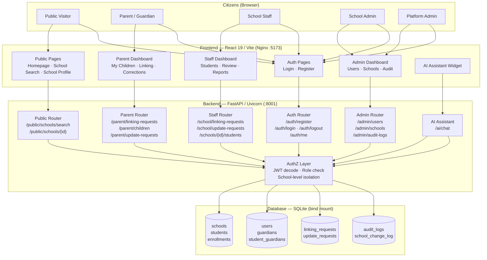

# NagrikSetu — System Architecture
*Phase 2 · 2026-10-30*

## System Overview

NagrikSetu School Service is a citizen-facing, government-style web portal built as a **modular monolithic** FastAPI backend served by Nginx-hosted React frontend, with SQLite persistence during development.

---

## Architecture Diagram



---

## Layer Responsibilities

### Presentation Layer (React Frontend)
- **Public Pages**: homepage, school search, school profile — no authentication required
- **Auth Pages**: login, register, password reset
- **Parent Dashboard**: link child, view records, track requests
- **Staff Dashboard**: review linking requests, review corrections, view student lists
- **Admin Dashboard**: manage users, schools, system config
- **AI Assistant Widget**: floating chat, role-aware, no direct DB access

### Application Layer (FastAPI Backend)
- **Public Router** (`/public`): returns only approved public fields, no auth
- **Auth Router** (`/auth`): registration (parent only), login, logout, me
- **Parent Router** (`/parent`): all parent operations, ownership enforced
- **Staff Router** (`/school`): school-scoped operations, school_id match enforced
- **Admin Router** (`/admin`): platform-wide operations, platform_admin only
- **AuthZ Layer**: JWT decode → DB user lookup → role check → school isolation

### Database Layer (SQLite)
All data persisted in `nagriksetu.db` bound to `/app/data/nagriksetu.db` inside the backend container.

### Infrastructure Layer
- Docker Compose orchestrates backend + frontend
- Nginx serves static React build on port 5173 (host) → 80 (container)
- Uvicorn serves FastAPI on port 8001 (host) → 8000 (container)
- SQLite database file bind-mounted from host for persistence

---

## Backend Module Structure (Target)

```
backend/
├── main.py              # App factory, middleware, router mounts
├── database.py          # Schema creation, migrations, get_connection()
├── auth.py              # JWT creation, verify, password hashing
├── routers/
│   ├── __init__.py
│   ├── public.py        # Public school endpoints (no auth)
│   ├── auth_routes.py   # Register, login, logout, me
│   ├── parent.py        # Parent-specific endpoints
│   ├── staff.py         # School staff endpoints
│   └── admin.py         # Platform admin endpoints
├── models.py            # Shared Pydantic models
└── utils.py             # Shared helpers (audit logging, etc.)
```

---

## Frontend Module Structure (Target)

```
frontend/src/
├── main.jsx             # React entry, Router, AuthProvider
├── App.jsx              # Route definitions
├── contexts/
│   └── AuthContext.jsx  # JWT storage, user state, login/logout
├── hooks/
│   ├── useAuth.js       # useContext(AuthContext)
│   └── useApi.js        # Fetch wrapper with auth header
├── utils/
│   ├── api.js           # API_URL, authenticated fetch helpers
│   └── auth.js          # Token parsing
├── components/
│   ├── layout/
│   │   ├── GovHeader.jsx    # Government-style masthead
│   │   ├── Navigation.jsx   # Main navigation bar
│   │   ├── Footer.jsx       # Footer with legal links
│   │   └── Breadcrumbs.jsx
│   └── ui/
│       ├── Button.jsx
│       ├── Alert.jsx
│       ├── LoadingSpinner.jsx
│       ├── EmptyState.jsx
│       ├── StatusBadge.jsx
│       ├── DataTable.jsx
│       ├── Pagination.jsx
│       └── SearchBar.jsx
└── pages/
    ├── public/
    │   ├── HomePage.jsx
    │   ├── SchoolSearchPage.jsx
    │   └── SchoolProfilePage.jsx
    ├── auth/
    │   ├── LoginPage.jsx
    │   └── RegisterPage.jsx
    ├── parent/
    │   ├── ParentDashboard.jsx
    │   ├── LinkChildPage.jsx
    │   ├── MyChildrenPage.jsx
    │   └── CorrectionRequestsPage.jsx
    ├── staff/
    │   ├── StaffDashboard.jsx
    │   ├── StudentsPage.jsx
    │   ├── LinkingReviewPage.jsx
    │   └── CorrectionReviewPage.jsx
    └── admin/
        └── AdminDashboard.jsx
```

---

## AI Assistant Architecture

```
User message → AI Widget (frontend)
               ↓ POST /ai/chat  (with JWT if logged in)
            Backend AI handler
               ↓ get_current_user() → role + school_id
               ↓ Build system prompt with role context
               ↓ Gemini API / rule-based fallback
               ↓ Response (never exposes private data)
            Widget displays response
```

- AI key stored only in backend environment variable `GEMINI_API_KEY`
- If key absent, widget falls back to rule-based FAQ responses
- AI cannot call internal APIs directly — backend mediates all data access

---

## Data Flow: Parent-Child Linking

```
Parent submits form → POST /parent/linking-requests
                       ↓ Creates linking_requests row (status=pending)
                       ↓ Returns request_id

School staff opens dashboard → GET /school/linking-requests
                                ↓ Returns pending requests for school

Staff approves → POST /school/linking-requests/{id}/review
                  ↓ Verifies request belongs to staff's school
                  ↓ Creates student_guardians row (is_verified=1)
                  ↓ Updates linking_requests.status → approved
                  ↓ Writes audit_logs entry
                  ↓ Transaction committed

Parent sees approved child → GET /parent/children
                              ↓ Returns verified linked children
```

---

## Security Architecture

| Layer | Control |
|---|---|
| Transport | HTTPS in production (Nginx TLS termination) |
| Authentication | Argon2 password hash, HS256 JWT (30 min expiry) |
| Authorization | Backend role check on every protected endpoint |
| School isolation | `user.school_id` compared to resource school_id |
| Parent isolation | `student_guardians.is_verified=1` AND `guardian_id` match |
| Input | Pydantic models, parameterized SQL |
| Secrets | Environment variables, never in frontend bundles |
| Audit | `audit_logs` table, `school_change_log` table |
| CORS | Restricted to known frontend origin |

---

## Deployment Architecture (Development)

```
Host (Windows)
├── Docker Desktop
│   ├── nagriksetu-backend   :8001 → :8000 (FastAPI + Uvicorn)
│   │   └── volume: ./backend/data:/app/data   (SQLite persistence)
│   └── nagriksetu-frontend  :5173 → :80      (Nginx + React build)
└── C:\Users\callm\nagriksetu\   (source code)
```

## Deployment Architecture (Production Target)

```
Domain (HTTPS)
├── Nginx (reverse proxy + TLS)
│   ├── → Frontend (static files or container)
│   └── → Backend (uvicorn, internal port)
├── Backend container (FastAPI)
│   └── volume: /data/nagriksetu.db  (or PostgreSQL)
└── Backup: nightly DB copy to safe location
```
