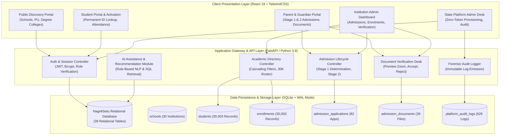
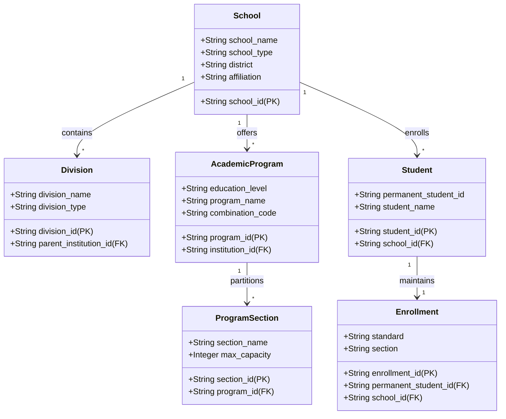
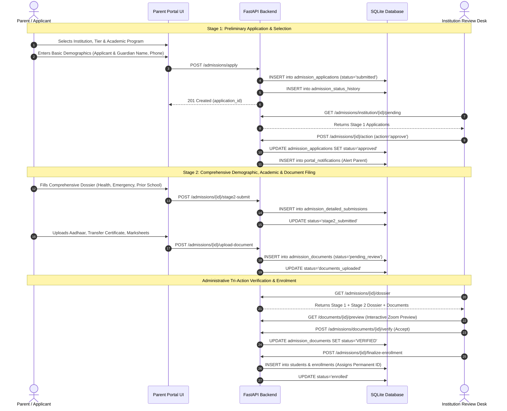

# NagrikSetu: System Architecture & Technical Specifications

**Document Version:** 1.0.0  
**Project:** NagrikSetu Unified Multi-Tier Digital Education and Institutional Governance Platform  
**Target Environment:** State of Karnataka, India  
**Date:** November 2026  

---

## 1. Architectural Overview & Design Philosophy

The **NagrikSetu** platform is engineered as a multi-tier, multi-tenant digital educational governance platform designed to unify primary schools, pre-university colleges, polytechnic diploma institutions, and autonomous universities across Karnataka under a cohesive, standardized, and high-performance framework.

The architecture emphasizes:
1. **Multi-Tenant Data Isolation:** Clear physical and logical separation of institutional data while allowing platform-wide discovery, cross-tier progression, and state-level governance oversight.
2. **Cascading Relational Hierarchy:** Seamless domain modeling catering to diverse educational structures—from single-standard K-10 primary schools with section divisions, up to collegiate universities with faculties, degree programs, semesters, and subject combinations.
3. **Two-Stage Digital Admission Pipeline:** Decoupling initial parent discovery and low-friction preliminary intent (Stage 1) from deep demographic, academic, and document verification onboarding (Stage 2).
4. **Tri-Action Forensic Document Verification:** Comprehensive administrative review desk offering authenticated preview with interactive zoom, single-click verification badge updates, and strict defect rejection with mandatory justification.
5. **Role-Based Access Control (RBAC):** Cryptographically enforced authorization preventing privilege escalation and cross-tenant data leakage.

---

## 2. Multi-Tenant Topology & Institutional Hierarchy

NagrikSetu models four distinct institutional archetypes within Karnataka's educational landscape:

| Tier Code | Institutional Category | Hierarchy Structure | Program & Combinations Modeling | Sample Institutions in DB |
| :--- | :--- | :--- | :--- | :--- |
| **SCH** | K-10 Primary & Secondary Schools | Institution -> Standard (1-10) -> Section (A, B, C) | General Curriculum, State Board / CBSE | Ballari Education School (SCH019), Bangalore High School (SCH001) |
| **PU** | Pre-University Colleges | Institution -> Class (11-12) -> Stream -> Combination | Science (PCMB, PCMC), Commerce (EBAC, HEBA), Arts (HEPyS) | Mangaluru PU College (SCH011), Mysuru Pre-University |
| **DIP** | Polytechnic Institutes | Institution -> Department -> Semester (1-6) -> Section | Diploma in CS, Mechanical, Civil, Electronics | Karnataka Government Polytechnic (SCH013) |
| **UNI** | Degree Colleges & Autonomous Universities | Institution -> Division / School -> Degree Program -> Semester -> Section | B.E., B.Tech, B.Arch, B.Pharm, MCA, MBA, Ph.D. | Visvesvaraya Technological University (SCH026), Bengaluru City University |

---

## 3. Two-Stage Digital Admission Engine

The admission subsystem enforces a rigorous two-stage lifecycle:

---

## 4. Administrative Document Verification Review Desk

The document verification system provides three core actions per document:
1. **View (Preview Modal):**
   - Secure authenticated streaming endpoint `GET /api/documents/{doc_id}/preview`.
   - Client-side zoom controller supporting granular 50% to 250% scaling, panning, rotation, and high-fidelity rendering of PDF, PNG, JPG, and JPEG.
2. **Accept Action:**
   - Single-click verification committing `VERIFIED` state.
   - Emits an immutable audit log into `audit_logs` tracking administrator ID, institution ID, and microsecond timestamp.
   - Updates document counter badges in real time.
3. **Reject Action:**
   - Enforces a mandatory structured defect reason selected from official compliance categories (Illegible Scan, Expired Document, Mismatched Name, Missing Signature, Fraudulent/Incomplete).
   - Allows optional administrator guidance notes.
   - Updates document status to `REJECTED` and triggers an urgent in-app notification to the parent for replacement document submission.

---

## 5. Security Architecture & RBAC Isolation

Security is enforced through multi-layered controls:
- **Session Tokens:** Cryptographic JWT tokens signed with SHA-256 HMAC containing user identity, role, and explicit institutional bindings.
- **Tenant Isolation Policy:** Every administrative request validates that the target `institution_id` matches the user's active token claims in `user_institution_roles`. Cross-tenant probes result in immediate `403 Forbidden` exceptions.
- **Zero-Token Invitation Protocol:** Platform administrators provision institutional administrators via an automated invitation handshake. Cryptographic tokens are stored strictly within the backend database (`invitation_tokens`), eliminating manual exposure of raw URLs or tokens.
- **Forensic Audit Trails:** Critical events (login, role assignment, document acceptance/rejection, enrollment finalization) are written synchronously to `platform_audit_logs` and `audit_logs`.

---

## 6. High-Performance Academic Roster Management

The platform handles 30,003 active enrolled students across 30 institutions. To maintain sub-50ms latency:
- Queries utilize compound indexed lookups on `(school_id, standard, section)`.
- Server-side pagination (`LIMIT` / `OFFSET`) ensures minimal memory allocation during directory browsing.
- Cascading drop-down filter APIs dynamically map:
  - **Schools:** Standard (1-10) -> Section (A, B, C, D)
  - **PU Colleges:** Stream (Science, Commerce, Arts) -> Combinations (PCMB, PCMC, EBAC, HEBA, HEPyS)
  - **Degree Colleges & Universities:** Faculty / School -> Degree Program (B.Tech, B.Arch, MCA) -> Semester (1-8) -> Section
