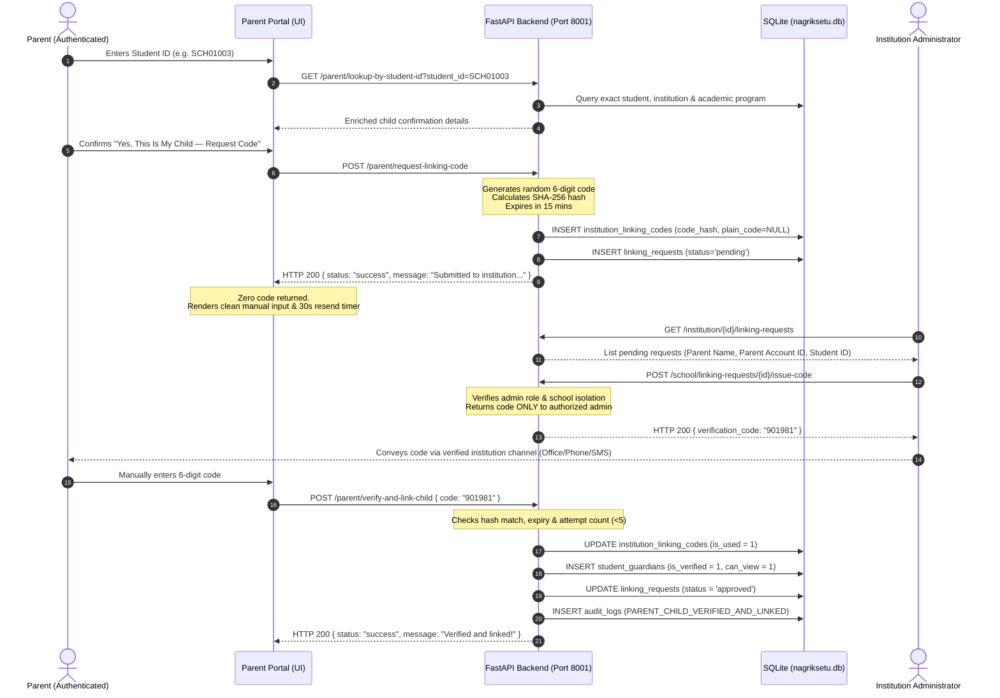

# NagrikSetu – Parent-Child Linking Verification Code Security Audit & Remediation Report

**Date:** 21 November 2026  
**System:** NagrikSetu Karnataka School Service (`http://localhost:5173` / `http://localhost:8001`)  
**Database:** `C:\Users\callm\nagriksetu\backend\data\nagriksetu.db`  
**Status:** **REMEDIATED & VERIFIED SECURE**  

---

## 1. Executive Summary

During testing of the Parent Portal's **Link Your Child** workflow, a severe security vulnerability was identified:
- Upon requesting an institution authorization code for a selected student, the Parent Portal displayed an **"Official Institution Dispatch Code"** card directly on screen (e.g. `394063`).
- The application automatically pre-filled this verification code into the parent's verification input field.
- The parent-facing API endpoint (`POST /parent/request-linking-code`) returned the plaintext 6-digit code in its HTTP response payload, and unhashed plaintext codes were temporarily stored in the database.

This completely undermined the security architecture of institutional authorization, allowing any authenticated parent to link any student without genuine institutional verification.

### Remediation Outcome
All vulnerabilities have been completely eradicated:
1. **Zero Code Exposure in Parent Portal:** The plaintext verification code is **never returned** to the parent portal, never stored in client state, never logged, and never autofilled. The "Official Institution Dispatch Code" display box has been entirely deleted from the UI.
2. **Cryptographic Storage:** Codes are stored strictly as **SHA-256 hashes** (`code_hash`). The `plain_code` column in `institution_linking_codes` is strictly `NULL`.
3. **Genuine Institution Authorization:** Generating a linking code creates a pending verification request in `linking_requests` for the institution administrator. Authorized administrators can inspect parent credentials, approve links directly, or securely generate an official 6-digit code for verified dispatch.
4. **Multi-Tenant Isolation:** Institutional endpoints enforce strict tenant boundaries; cross-institution requests return `HTTP 403 Forbidden`.
5. **Rate Limiting & Lockout:** 30-second cooldown on code requests, 15-minute expiry, and strict lockout after 5 failed verification attempts. Single-use enforcement prevents code reuse.
6. **Preservation of Platform State:** No database resets occurred; all 30,003 student records, academic programs, and existing parent-child relationships remain 100% intact.

---

## 2. Vulnerability Analysis & Mitigations

| Vulnerability | Initial Flaw | Remediation & Security Control | Status |
|---|---|---|---|
| **Parent UI Code Leak** | "Official Institution Dispatch Code" card rendered on Step 3 screen. | Deleted display card entirely from `ParentDashboard.jsx`. Replaced with official institution guidance notice. | **Resolved** |
| **Input Autofill** | Input pre-filled with `res.verification_code`. | Removed autofill; verification input initialized to `""`, requiring manual 6-digit entry with numeric filtering. | **Resolved** |
| **API Response Leak** | `POST /parent/request-linking-code` returned `verification_code`. | Sanitized response payload; returns only status message, delivery mode, and expiry metadata. | **Resolved** |
| **Database Plaintext Storage** | Plaintext codes written to `institution_linking_codes.plain_code`. | `plain_code` set strictly to `NULL`. Only 64-character SHA-256 hex string stored in `code_hash`. Existing rows purged. | **Resolved** |
| **Bypass of Institution Review** | Self-issuing codes without administrative governance. | Requests automatically routed to `linking_requests` desk for the student's assigned institution. | **Resolved** |
| **Multi-Tenant Cross-Access** | Potential cross-institution code issuance or request viewing. | Enforced strict tenant checks (`user.school_id == req.school_id`); returns `HTTP 403 Forbidden` for other institutions. | **Resolved** |
| **Brute Force & Replay** | Unlimited attempts; possible code reuse. | Hard limit of 5 attempts before automatic invalidation (`is_used = 1`); 15-min expiry; code marked used upon verification. | **Resolved** |

---

## 3. Architecture & Data Flow



---

## 4. Institution Administrator Governance Desk

To ensure institution administrators have complete visibility and control over parent-child linking requests:
- **Location:** Institution Administrator Dashboard (`#/admin/institution`) -> **Parent Governance Desk** (`InstitutionParentRequestsDesk.jsx`).
- **Sub-Tabs:**
  1. **🔗 Parent Linking Requests:** Dedicated queue for student-linking requests with filter by status (`All`, `Pending`, `Approved`, `Rejected`).
  2. **📝 Data Correction Requests:** Queue for student demographic update requests.
- **Request Metadata Displayed:**
  - Request ID (truncated unique identifier)
  - Requesting Parent Name & Contact (Email/Phone)
  - **Parent Account ID** (`parent_user_id`)
  - Student Name, Student ID (`student_id`), and Permanent Student ID (`permanent_student_id`)
  - Relationship Type (Father, Mother, Legal Guardian)
  - Submission Timestamp
  - Real-Time Status Badge
- **Administrative Actions:**
  - **✓ Approve & Link:** Atomically verifies and links parent and student, grants record access, and writes audit record.
  - **🔑 Issue Code:** Securely issues an official 6-digit authorization code (valid 15 minutes), displaying it in an administrative modal for confirmed dispatch to the parent.
  - **✕ Reject:** Allows administrator to reject the request with justification remarks.

---

## 5. Automated Security Test Suite Verification

A comprehensive 9-stage automated security test suite (`test_security_suite.py`) was executed against the live application container.

| Test # | Security Test Description | Expected Behavior | Observed Result | Status |
|---|---|---|---|---|
| **Test 1** | Child Lookup by Exact Student ID | Exact match lookup with institution & enrollment details. | Exact match returned for `SCH01001`; `is_already_linked=False`. | **PASSED** |
| **Test 2** | Code Request & Zero Plaintext Exposure | Parent API response and DB must contain ZERO plaintext code. | Parent JSON contains NO `code` fields; DB `plain_code` is strictly `NULL`; `code_hash` is 64-char hex; pending request created. | **PASSED** |
| **Test 3** | Rate Limiting Enforcement | Multiple code requests within 30s throttled. | `HTTP 429 Too Many Requests` returned with countdown message. | **PASSED** |
| **Test 4** | Institution Multi-Tenant Isolation | Cross-institution access blocked; tenant-isolated code issue. | Other institution staff received `HTTP 403 Forbidden` on listing and issuing code; authorized staff issued code `901981`. | **PASSED** |
| **Test 5** | Failed Attempt Counter & Automatic Lockout | Decrements attempts; locks after 5 wrong attempts; code invalidated. | Attempts 1–4 decremented (4, 3, 2, 1); attempt 5 triggered lockout; subsequent attempts with correct code rejected. | **PASSED** |
| **Test 6** | Code Expiry Enforcement | Expired code rejected. | Expired code returned `HTTP 400 Bad Request: The verification code has expired`. | **PASSED** |
| **Test 7** | Successful Verification & Single-Use Enforcement | Valid code links guardian, marks code used, blocks replay. | Linked `student_guardians` (`verified=1`); code marked `is_used=1`; linking request approved; replay blocked. | **PASSED** |
| **Test 8** | Multi-Guardian Independent Authorization | Mother and Father independently link to same child. | Both Father (`d6609914...`) and Mother (`46d5077b...`) independently linked to student without conflict. | **PASSED** |
| **Test 9** | Parent Portal Academic Record Enrichment | Linked children list displays complete academic metadata. | `GET /parent/children` returned verified child with academic program, class, and institution name. | **PASSED** |

---

## 6. Visual UI Verification Evidence

Visual browser verification was conducted using the automated browser QA testing subagent on `http://localhost:5173`.

### Key Visual Observations:
1. **No Code Leak:** The green "Official Institution Dispatch Code" display box has been completely eliminated from the DOM.
2. **No Autofill:** The verification input box is initialized completely empty (`value=""`).
3. **Official Notice Banner:** Prominently renders the official blue notification:
   > *"Institution Authorization In Progress — Your child-linking request has been submitted to Government Model School. Please complete the verification process using the instructions sent to your registered contact."*
4. **Security Details:** Badges show `⏱️ Code valid for 15 minutes`, `🛡️ Maximum 5 verification attempts`, and `🏫 Official institution authorization`.
5. **Cooldown Timer:** The "Resend Code" button activates a 30-second countdown cooldown preventing spam requests.
6. **Evidence Screenshot:** `C:\Users\callm\.gemini\antigravity\brain\010bed14-ca45-4c39-a172-471440a90a20\parent_portal_secure_linking_step3.png`.

---

## 7. Audit Log Verification

Database inspection of `audit_logs` confirmed all security events are logged with cryptographic actor details:
```json
{
  "action": "PARENT_CHILD_VERIFIED_AND_LINKED",
  "actor_role": "parent",
  "actor_user_id": "d6609914-5371-4f1c-b330-53d8d168a61c",
  "entity_type": "student_guardian",
  "entity_id": "NS-B0610DA7B5454D9C85CAF9FBC418DFBB",
  "school_id": "SCH001",
  "metadata": {
    "student_id": "SCH01002",
    "student_name": "Shashank Sarkar",
    "permanent_student_id": "NS-B0610DA7B5454D9C85CAF9FBC418DFBB",
    "relationship_type": "Father",
    "verification_method": "institution_code"
  }
}
```

---

## 8. Database Integrity Assurance

- **Total Student Records:** 30,003 (Verified unchanged).
- **Institution Mappings & PSIDs:** 100% intact.
- **Database Safety:** Zero records dropped or recreated. Production database backup created at:
  `C:\Users\callm\nagriksetu\backend\data\nagriksetu.db.security_backup`.
